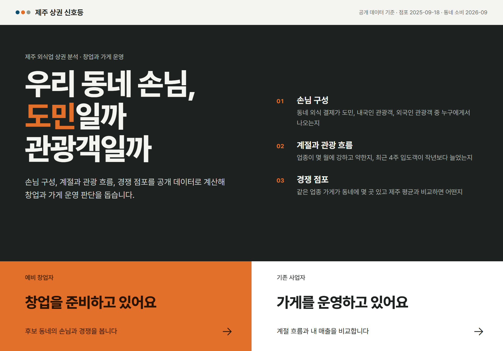
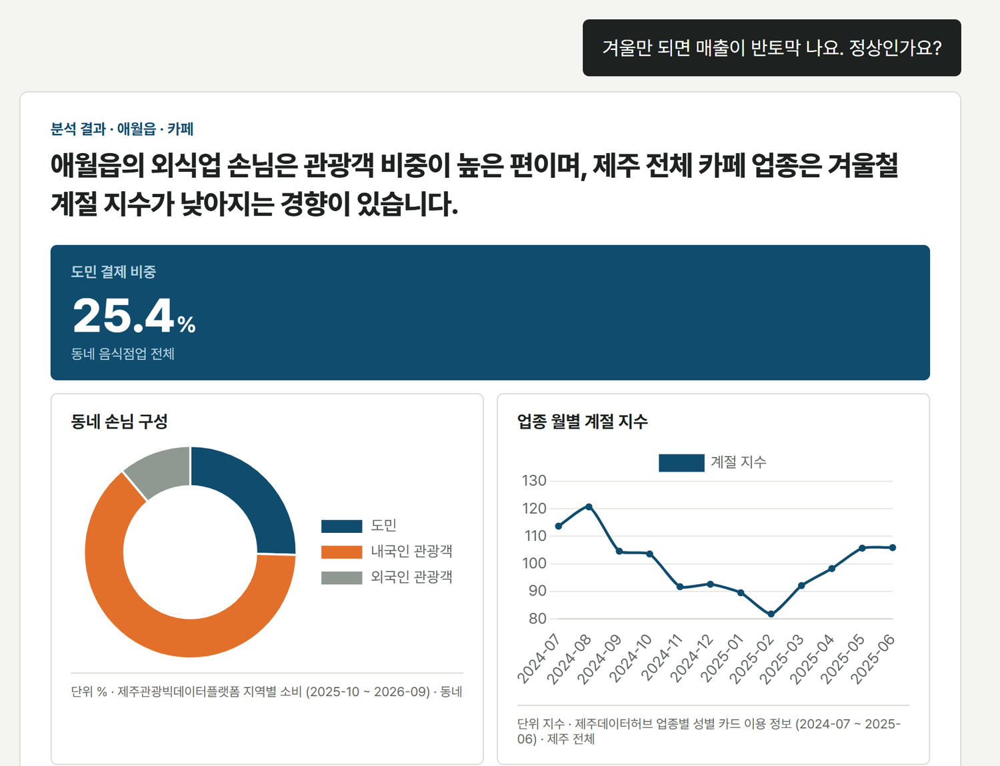
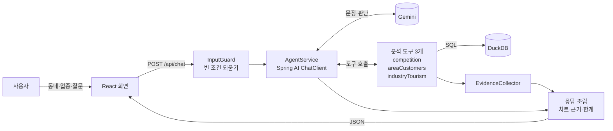

<div align="center">

# 제주 상권 신호등

**우리 동네 손님, 도민일까 관광객일까**

제주 외식업 창업자와 사장님의 질문에 공개 데이터로 계산한 숫자와 차트로 답하는 AI 에이전트


 

</div>

## 목차

- [소개](#소개)
- [주요 기능](#주요-기능)
- [동작 방식](#동작-방식)
- [빠른 시작](#빠른-시작)
- [환경변수](#환경변수)
- [사용 예시](#사용-예시)
- [에이전트 평가](#에이전트-평가)
- [데이터](#데이터)
- [기술 스택](#기술-스택)
- [프로젝트 구조](#프로젝트-구조)
- [문서](#문서)

## 소개

제주 외식업은 관광객 흐름과 계절에 따라 매출이 크게 흔들립니다. 같은 카페라도 손님이 주로 도민인 동네와 관광객인 동네는 겨울 매출이 전혀 다르게 움직입니다. 그런데 이런 정보는 여러 공공 데이터에 흩어져 있어 창업자나 사장님이 직접 찾아 계산하기 어렵습니다.

제주 상권 신호등은 동네와 업종을 고르고 "겨울만 되면 매출이 반토막 나요. 정상인가요?"처럼 평소 말투로 물으면, 아래 내용을 계산해 답합니다.

- 동네 외식 손님 중 도민, 내국인 관광객, 외국인 관광객의 비중
- 업종이 몇 월에 강하고 약한지, 최근 4주 입도 관광객이 작년보다 늘었는지
- 같은 업종 가게가 동네에 몇 곳 있고 제주 평균과 비교하면 어떤지

답에 나오는 모든 숫자는 LLM이 아니라 코드가 데이터베이스에서 계산한 값입니다. 데이터로 답할 수 없는 질문은 지어내지 않고 거절한 뒤, 대신 볼 수 있는 분석을 제안합니다.

## 주요 기능

| 기능 | 설명 |
|---|---|
| 질문 이해와 도구 선택 | 질문에 맞는 분석 도구 3개(경쟁 점포, 동네 손님, 업종 관광 성격)를 골라 조합합니다 |
| 숫자 근거 고정 | LLM은 문장과 차트 종류만 정하고, 숫자와 차트 데이터는 도구 결과로 코드가 채웁니다 |
| 거절과 되묻기 | 시간대, 예상매출, 개별 가게, 폐업 예측처럼 데이터에 없는 질문은 거절합니다. 조건이 빠지면 LLM을 부르지 않고 되묻습니다 |
| 근거와 한계 표시 | 답마다 사용한 데이터의 출처, 기간, 기준(동네 또는 제주 전체)과 해석할 때 주의할 점을 붙입니다 |
| 내 가게 비교 | 기존 사업자가 월매출을 넣으면 동네 결제 흐름, 관광객 흐름과 나란히 비교합니다 |
| 동네 비교와 후속 질문 | 두 동네를 같은 기준으로 비교하고, 같은 세션 안에서는 앞 대화를 이어 답합니다 |
| 표본 부족 처리 | 최근 12개월 표본이 부족하면 24개월로 넓혀 계산하고 그 사실을 알립니다 |
| 키오스크 화면 | 큰 글씨와 큰 버튼, 5분 동안 입력이 없으면 10초 안내 뒤 처음 화면으로 돌아갑니다 |

## 동작 방식



1. 화면에서 고른 동네, 업종, 질문이 서버로 들어옵니다. 조건이 비어 있으면 LLM 없이 바로 되묻습니다.
2. LLM이 질문을 답변, 거절, 되묻기 중 하나로 판단하고, 답변이면 필요한 도구를 고릅니다. 도구 호출은 한 질문에 최대 6번입니다.
3. 도구는 DuckDB에서 지표를 계산하고, 그 결과를 근거 수집기에 함께 저장합니다.
4. LLM은 숫자 필드가 없는 구조화 응답(요약, 섹션, 차트 종류, 다음 질문 제안)을 돌려줍니다.
5. 서버가 저장된 도구 결과로 차트 데이터, 근거 목록, 한계 문구를 만들어 응답을 완성합니다.

앱이 시작될 때 `data/raw`의 CSV 4개를 `data/sql`의 SQL로 정제해 DuckDB 파일을 만듭니다. 데이터베이스 서버를 따로 설치할 필요가 없습니다.

## 빠른 시작

### 요구 사항

| 도구 | 버전 | 비고 |
|---|---|---|
| JDK | 21 | 필수 |
| Node.js | 22.12 이상 (또는 20.19 이상) | 화면을 빌드할 때만 필요 |
| Gemini API 키 | | [Google AI Studio](https://aistudio.google.com/apikey)에서 발급 |

Maven은 설치하지 않아도 됩니다. `backend/mvnw`가 필요한 버전을 내려받아 사용합니다.

### 1. 저장소 받기와 키 설정

```bash
git clone https://github.com/retry2026/jeju-biz-signal.git
cd jeju-biz-signal
cp .env.example .env
```

`.env`의 `LLM_API_KEY`에 발급받은 키를 넣습니다. `.env`는 Git에 올라가지 않습니다.

### 2. 빌드와 실행

```bash
cd frontend && npm install && npm run build && cd ..
cd backend && ./mvnw package
java -jar target/jeju-agent.jar
```

화면 빌드 결과가 jar 안에 함께 들어갑니다. 실행 뒤 브라우저에서 http://localhost:8080 에 접속합니다.

> Windows 명령 프롬프트에서는 `./mvnw` 대신 `mvnw.cmd`를 씁니다.
> jar는 `backend` 폴더에서 실행합니다. 데이터 폴더 기본 위치가 `backend` 기준 `../data`이기 때문입니다.

### 개발 모드

백엔드와 화면을 각각 띄우면 화면 코드를 고칠 때 바로 반영됩니다.

```bash
cd backend && ./mvnw spring-boot:run
```

```bash
cd frontend && npm install && npm run dev
```

http://localhost:5173 에서 화면이 열리고, `/api` 요청은 백엔드(8080)로 전달됩니다.

### 테스트

```bash
cd backend && ./mvnw test
```

```bash
cd frontend && npm run lint && npm test
```

## 환경변수

`.env` 파일이나 시스템 환경변수로 설정합니다.

| 이름 | 필수 | 기본값 | 설명 |
|---|---|---|---|
| `LLM_PROVIDER` | 예 | `none` | `google-genai`로 설정하면 Gemini를 사용합니다. 설정하지 않으면 앱은 뜨지만 질문에는 답하지 않습니다 |
| `LLM_API_KEY` | 예 | | Gemini API 키 |
| `LLM_MODEL` | 아니오 | `gemini-3.5-flash-lite` | 기본 모델 |
| `LLM_FALLBACK_MODELS` | 아니오 | `gemini-3-flash-preview,gemini-3.8-flash` | 기본 모델이 할당량 초과나 과부하로 실패하면 순서대로 시도할 모델 (쉼표 구분) |
| `DATA_DIR` | 아니오 | `../data` | 데이터 폴더 경로 (`backend` 폴더 기준) |
| `SERVER_PORT` | 아니오 | `8080` | 서버 포트. `.env`가 아니라 시스템 환경변수나 실행 인자(`java -jar target/jeju-agent.jar --server.port=9090`)로 바꿉니다 |

## 사용 예시

1. 시작 화면에서 **창업을 준비하고 있어요** 또는 **가게를 운영하고 있어요**를 고릅니다.
2. 동네(제주 43개 읍면동)와 업종(카페, 한식, 중식, 일식, 양식, 주점, 패스트푸드)을 고릅니다.
3. 화면의 예시 질문 버튼을 누르거나 직접 질문합니다. 기존 사업자는 최근 월매출을 넣으면 내 가게와 비교해 볼 수 있습니다.

아래는 직접 물어볼 수 있는 질문의 예입니다.

| 상황 | 질문 | 답에 담기는 내용 |
|---|---|---|
| 창업 입지 | 노형동에 브런치 카페 차리려는데 괜찮을까요? | 경쟁 점포 수와 제주 평균 대비 밀도, 동네 손님 구성, 카페 업종의 관광 성격 |
| 계절 변동 | 겨울만 되면 매출이 반토막 나요. 정상인가요? | 동네 관광객 비중, 업종 월별 계절 지수, 최근 입도 관광객 흐름 |
| 매출 하락 원인 | 작년보다 매출이 줄었는데 우리 가게 문제인가요? | 내 매출 변화와 동네 결제 변화, 관광객 흐름 비교 |
| 동네 비교 | 이 동네와 애월읍 손님 구성을 비교해 주세요 | 두 동네의 손님 구성을 같은 기준으로 비교 |

### 답하지 않는 질문

아래 질문은 데이터가 없으므로 숫자를 지어내지 않고 거절한 뒤 대신 볼 수 있는 분석을 제안합니다.

| 질문 유형 | 예시 | 이유 |
|---|---|---|
| 시간대 | 저녁 장사는 어때요? | 시간대별 데이터가 없습니다 |
| 예상매출 | 여기 월매출 얼마 나와요? | 위치별 매출을 추정하지 않습니다 |
| 개별 가게 | 옆집 매출 얼마예요? | 개별 가게 데이터가 없고 제공하지도 않습니다 |
| 폐업 예측 | 이 가게 망할까요? | 예측하지 않습니다 |
| 그 밖의 정보 | 임대료, 권리금, 소득, 배달, 유동인구 | 데이터가 없습니다 |

## 에이전트 평가

정답을 SQL로 미리 계산해 둔 질문 30개로 에이전트를 평가합니다. 질문은 창업 입지 7개, 계절과 관광 9개, 내 가게 비교 4개, 거절 5개, 되묻기 5개로 구성됩니다.

```bash
cd backend && ./mvnw spring-boot:run -Dspring-boot.run.profiles=eval
```

결과는 `eval/results/`에 Markdown으로 저장됩니다. 같은 질문을 기본 3회 반복하며, 횟수는 아래처럼 바꿀 수 있습니다. 질문 형식은 `eval/questions.example.yaml`을 참고합니다.

```bash
cd backend && ./mvnw spring-boot:run -Dspring-boot.run.profiles=eval -Dspring-boot.run.arguments="--app.eval.repeat=1"
```

최근 결과 (`gemini-3.5-flash-lite`, 30개 × 1회, 실행 오류 0)

| 지표 | 의미 | 결과 |
|---|---|---|
| 판단 정확도 | 답변, 거절, 되묻기를 맞게 골랐는가 | 100% (30/30) |
| 도구 선택 정확도 | 답변 질문에서 필요한 도구를 모두 불렀는가 | 100% (20/20) |
| 수치 정확도 | 핵심 숫자가 정답 SQL 결과와 맞는가 | 90.9% (10/11) |
| 거절 정확도 | 데이터에 없는 질문을 거절했는가 | 100% (5/5) |
| 근거 없는 숫자 비율 | 답 문장의 숫자 중 도구 결과에 없는 숫자 | 1.9% (2/104) |
| 평균 응답 시간 | 질문 하나에 답하기까지 걸린 시간 | 약 7초 |

원본 결과는 [`eval/results/2026-11-19-1633.md`](eval/results/2026-11-19-1633.md)에 있습니다.

## 데이터

| 데이터 | 제공처 | 기간 | 쓰이는 곳 |
|---|---|---|---|
| 제주특별자치도 상가(상권) 정보 | 제주데이터허브 | 2025-09-18 기준 | 경쟁 점포 수와 밀도 |
| 업종별 성별 카드 이용 정보 | 제주데이터허브 (제주빅데이터센터) | 2018-01 ~ 2025-06 | 업종의 관광객 비중, 계절 지수 |
| 제주 지역별 소비 | 제주관광빅데이터플랫폼 (제주관광공사) | 2020-01 ~ 2026-09 | 동네 손님 구성, 전년 대비 |
| 일별 입도 관광객 | 제주관광빅데이터플랫폼 (제주관광협회) | 2013-08-01 ~ 2026-11-16 | 최근 4주 관광객 흐름 |

원본 CSV는 `data/raw`에, 정제 SQL은 `data/sql`에 있어 같은 입력이면 언제나 같은 숫자가 나옵니다. 정제 규칙과 데이터 한계는 [`docs/데이터활용명세.md`](docs/데이터활용명세.md)에 정리했습니다.

데이터에는 다음 한계가 있으며, 답변에도 그대로 밝힙니다.

- 동네 소비 데이터는 음식점업 전체 기준이라 세부 업종(카페, 한식 등)으로 나뉘지 않습니다.
- 업종 카드 데이터는 제주 전체 집계라 동네 단위가 아닙니다.
- 데이터마다 기준 시점이 달라, 숫자마다 기준 기간을 함께 표시합니다.
- 카드 결제 기반 추정치이며 실제 매출 총액이 아닙니다.

## 기술 스택

| 구분 | 사용 기술 |
|---|---|
| 백엔드 | Java 21, Spring Boot 4.1, Spring AI 2.0 (도구 호출, 구조화 출력, 대화 메모리) |
| LLM | Google Gemini (`gemini-3.5-flash-lite`, 실패 시 대체 모델로 자동 전환) |
| 데이터 | DuckDB (내장 파일 DB), Spring `JdbcClient` |
| 화면 | React 19, TypeScript, Vite 8, Chart.js 4 |
| 빌드 | Maven Wrapper, npm |

## 프로젝트 구조

```
jeju-biz-signal/
├── backend/
│   └── src/main/
│       ├── java/kr/jeju/agent/
│       │   ├── agent/    에이전트 (입력 검사, LLM 호출, 도구, 근거 수집, 한계 문구)
│       │   ├── metric/   분석 도구가 쓰는 지표 계산
│       │   ├── chart/    도구 결과로 차트 데이터 생성
│       │   ├── web/      REST API와 세션 관리
│       │   ├── config/   시작 시 데이터 적재
│       │   └── eval/     에이전트 평가 실행기와 채점기
│       └── resources/
│           └── prompts/  시스템 프롬프트, 거절 규칙
├── frontend/             React 화면
├── data/
│   ├── raw/              원본 CSV 4종
│   └── sql/              정제와 분석용 뷰를 만드는 SQL
├── eval/
│   ├── questions.yaml    평가 질문 30개
│   ├── gold/             정답 계산 SQL
│   └── results/          평가 결과
└── docs/                 기획, 설계, API, 데이터 문서
```

## 문서

| 문서 | 내용 |
|---|---|
| [`docs/PRD.md`](docs/PRD.md) | 제품 요구사항, 사용자 시나리오 |
| [`docs/TRD.md`](docs/TRD.md) | 기술 구조와 요청 흐름 |
| [`docs/API명세.md`](docs/API명세.md) | 화면 API(`GET /api/meta`, `POST /api/chat`)와 분석 도구 계약 |
| [`docs/metric-spec.md`](docs/metric-spec.md) | 지표 계산 규칙 |
| [`docs/데이터활용명세.md`](docs/데이터활용명세.md) | 데이터 출처, 전처리, 한계 |
| [`docs/ai-usage.md`](docs/ai-usage.md) | 개발에 사용한 AI 도구와 범위 |

## 출처

- 제주데이터허브, 제주특별자치도 상가(상권) 정보 (2025-09-18)
- 제주데이터허브(제주빅데이터센터), 업종별 성별 카드 이용 정보 (2018-01 ~ 2025-06)
- 제주관광공사 제주관광빅데이터플랫폼, 제주 지역별 소비 (2020-01 ~ 2026-09), 공공누리 제1유형
- 제주관광협회 제주관광빅데이터플랫폼, 일별 입도 관광객 (2013-08-01 ~ 2026-11-16), 공공누리 제1유형

이 프로젝트는 2026 제주 AI·빅데이터 활용 AI Agent 개발 챌린지 출품작입니다.
